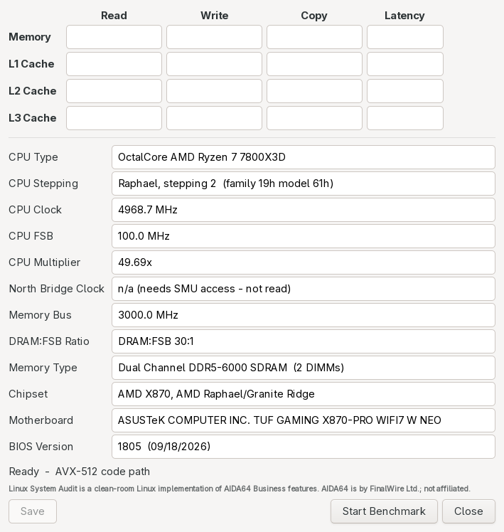

# Linux System Audit - User Guide

Version 0.1.3. Covers Linux (Arch package, AUR, generic tarball, source build) and the Windows build.

> **About the name and credit.** Linux System Audit (LSA, package `lsa-sysinfo`) is a clean-room
> Linux implementation of AIDA64 Business features. **AIDA64 is made by FinalWire Ltd.**
> (<https://www.aida64.com>). LSA is an independent project. It is **not affiliated with, endorsed
> by or connected to FinalWire**. It contains no AIDA64 code, binaries or data. No AIDA64 code was
> disassembled, decompiled or copied, and AIDA64's hardware database and artwork are not used.
> Please do not send LSA questions to FinalWire. See `EVIDENCE.md` in the source for how the
> specification was made.

Other pages:

- [CLI-REFERENCE.md](CLI-REFERENCE.md) - every command and option, with examples.
- [GLOSSARY.md](GLOSSARY.md) - every technical word used here, in plain English.

---

## Contents

1. [What it is, in plain words](#1-what-it-is-in-plain-words)
2. [Who it is for](#2-who-it-is-for)
3. [Install](#3-install)
4. [First launch](#4-first-launch)
5. [A tour of the window](#5-a-tour-of-the-window)
6. [What each number means](#6-what-each-number-means)
7. [How the tests work (the detail)](#7-how-the-tests-work-the-detail)
8. [Saving results and the run history](#8-saving-results-and-the-run-history)
9. [Reading results and comparing runs](#9-reading-results-and-comparing-runs)
10. [Known limits and known differences from AIDA64](#10-known-limits-and-known-differences-from-aida64)
11. [Windows build](#11-windows-build)
12. [Settings and files](#12-settings-and-files)
13. [Troubleshooting](#13-troubleshooting)
14. [Uninstall](#14-uninstall)
15. [FAQ](#15-faq)
16. [Glossary](#16-glossary)

---

## 1. What it is, in plain words

LSA measures **how fast your computer can move data** between the processor and its memory.

It does this for four places where data can live:

- **Memory** - your RAM sticks. Big, but the slowest.
- **L1 cache** - a tiny, very fast store inside each CPU core.
- **L2 cache** - bigger and a bit slower, also per core.
- **L3 cache** - bigger again, shared by many cores.

For each place it measures four things:

| Test | Plain words | Unit |
|---|---|---|
| **Read** | How much data per second the CPU can read. | MB/s (memory) or GB/s (caches) |
| **Write** | How much data per second the CPU can write. | MB/s or GB/s |
| **Copy** | How much data per second it can read and write back somewhere else. | MB/s or GB/s |
| **Latency** | How long one single, unpredictable read takes. Lower is better. | ns (nanoseconds) |

The result is a 4 x 4 grid, laid out like the familiar AIDA64 Cache & Memory Benchmark window,
so you can compare a Linux run with a Windows run on the same PC.

This is the first tool of LSA. The project plans more of AIDA64's pages and tools later
(`CHECKLIST.tsv` lists 162 planned items), but today LSA is the Cache & Memory Benchmark only.

## 2. Who it is for

- **Beginners** who want one number to check their RAM is running at the speed they paid for
  (for example after turning on XMP or EXPO in the BIOS).
- **Tuners and overclockers** who change memory timings, Infinity Fabric clock (FCLK) or similar
  BIOS settings and want to see the effect.
- **Dual-booters** who want to compare Linux with Windows, or LSA with AIDA64, on the same machine.
- **Developers and reviewers** who want a scriptable command-line benchmark with plain text output.

## 3. Install

LSA runs on 64-bit x86 Linux (Intel or AMD). It needs GTK 3 for the window. The command line
needs only glibc.

### 3.1 Arch Linux and derivatives - AUR

The package name is **`lsa-sysinfo`**. With an AUR helper:

```
yay -S lsa-sysinfo
```

or by hand:

```
git clone https://aur.archlinux.org/lsa-sysinfo.git
cd lsa-sysinfo
makepkg -si
```

### 3.2 Arch Linux - prebuilt package from the release

Each GitHub release has `lsa-sysinfo-<version>-1-x86_64.pkg.tar.zst`. Install it with:

```
sudo pacman -U lsa-sysinfo-0.1.3-1-x86_64.pkg.tar.zst
```

### 3.3 Any other distribution - generic tarball

Each release also has `lsa-sysinfo-<version>-linux-x86_64.tar.gz`. It was built on an older
distribution (Ubuntu 22.04), so it runs on most current ones (glibc 2.34 or newer, GTK 3).
The fast AVX2 / AVX-512 code is picked at run time, only if your CPU has it.

```
tar xzf lsa-sysinfo-0.1.3-linux-x86_64.tar.gz
cd lsa-sysinfo-0.1.3-linux-x86_64
./usr/bin/lsa --version          # try it without installing
./usr/bin/lsa-gui
sudo cp -r usr/bin usr/share /usr/local/     # install for all users
```

Read `INSTALL.txt` inside the tarball for the full list of run-time needs.

### 3.4 Build from source

You need `gcc`, `make`, `pkg-config` and the GTK 3 development files
(Arch: `gtk3`; Debian/Ubuntu: `libgtk-3-dev`; Fedora: `gtk3-devel`).

```
git clone https://github.com/eugenesflanagin-spec/lsa-sysinfo.git
cd lsa-sysinfo
make native                         # builds dist/native/lsa and dist/native/lsa-gui
make install                        # per-user install into ~/.local
# or, system-wide (what the Arch package does):
sudo make install-system DESTDIR= SYSPREFIX=/usr
```

`make install` puts the programs in `~/.local/bin`. Make sure that folder is on your `PATH`.

### 3.5 Optional: memory details from srs-sysinfo

LSA can show your memory type and speed (for example "Dual Channel DDR5-6000 SDRAM (2 DIMMs)").
Reading that needs root, so LSA borrows it from a small cache file written by `srs-root`,
part of the sister project **srs-sysinfo**:

```
yay -S srs-sysinfo        # or install it from its own release
pkexec srs-root            # one password prompt; writes ~/.cache/srs/root/dmidecode.txt
```

Without it, the benchmark works fine. Only the "Memory Bus", "DRAM:FSB Ratio" and
"Memory Type" lines stay empty.

### 3.6 Windows

See [section 11](#11-windows-build).

## 4. First launch

Open your application menu and look for **LSA Cache & Memory Benchmark**
(category System / Monitor; on some desktops under Benchmarks). Or type `lsa-gui` in a terminal.

The window opens with an **empty grid** and the system lines filled in. Nothing runs yet.



*The window before a run, on the author's Ryzen 7 7800X3D. The grid fills in, cell by cell,
when you press Start Benchmark.*

Before you press **Start Benchmark**:

1. **Close heavy programs** - games, browsers with video, compiles, virtual machines, file copies.
   Anything that uses the CPU or memory makes the results lower and less steady.
2. **Never run another memory benchmark at the same time** - for example AIDA64 under Wine, or a
   second copy of LSA. Both runs would fight for the memory bus and both results would be wrong
   (latency can double).
3. Press **Start Benchmark**. A dialog warns that every CPU thread and the memory bus will be busy
   for about 20 seconds. Press **OK**.

The run takes about 20 seconds. The cell being measured turns yellow and shows `...`, and the
status line says, for example, `Measuring L2 Cache Copy ...`. Your PC may feel slow during the run.
That is normal.

To stop early, press the same button (it now says **Stop**). Closing the window also stops the run.

## 5. A tour of the window

There is one window. From top to bottom:

### 5.1 The results grid

| | Read | Write | Copy | Latency |
|---|---|---|---|---|
| **Memory** | MB/s | MB/s | MB/s | ns |
| **L1 Cache** | GB/s | GB/s | GB/s | ns |
| **L2 Cache** | GB/s | GB/s | GB/s | ns |
| **L3 Cache** | GB/s | GB/s | GB/s | ns |

Empty cells have not been measured yet. A cell that stays empty after a run was skipped
(this can happen if you stopped the run).

### 5.2 The system lines

These describe the machine the numbers belong to. They are filled when the window opens
and refreshed after each run (the clock is measured again).

| Line | What it shows | Where it comes from |
|---|---|---|
| **CPU Type** | Core count as a word plus the model, e.g. `OctalCore AMD Ryzen 7 7800X3D`. | `/proc/cpuinfo` |
| **CPU Stepping** | Code name, stepping and family/model, e.g. `Raphael, stepping 2 (family 19h model 61h)`. | `/proc/cpuinfo` plus a built-in code-name table |
| **CPU Clock** | The core clock LSA **measured** a moment ago, e.g. `4968.7 MHz`. It moves a little run to run, because modern CPUs change clock all the time. | A short timing loop |
| **CPU FSB** | The reference (base) clock. LSA shows `100.0 MHz`, the standard value on current desktop CPUs. It is not read from the hardware. | Fixed value |
| **CPU Multiplier** | CPU Clock divided by 100, e.g. `49.69x`. | Calculated |
| **North Bridge Clock** | Shown as `n/a (needs SMU access - not read)`. LSA does not talk to the CPU's management firmware. | - |
| **Memory Bus** | The real memory clock, half the "MT/s" figure, e.g. `3000.0 MHz` for DDR5-6000. | srs-root DMI cache (optional) |
| **DRAM:FSB Ratio** | Memory clock divided by the 100 MHz reference, e.g. `DRAM:FSB 30:1`. | Calculated |
| **Memory Type** | Channels, type, speed and DIMM count, e.g. `Dual Channel DDR5-6000 SDRAM (2 DIMMs)`. | srs-root DMI cache (optional) |
| **Chipset** | The motherboard chipset and CPU platform, e.g. `AMD X870, AMD Raphael/Granite Ridge`. | PCI devices + hwdata `pci.ids` |
| **Motherboard** | Maker and board name. | `/sys/class/dmi/id/board_*` |
| **BIOS Version** | BIOS version and date. | `/sys/class/dmi/id/bios_*` |

### 5.3 Status line and buttons

- **Status line** - before a run: `Ready - AVX-512 code path` (the fastest instruction set your
  CPU has, see [7.4](#74-code-paths-avx-512-avx2-sse2)). During a run: the cell being measured.
  After: `Finished - AVX-512 code path, 16 threads` (or `Stopped ...`). After saving: `Saved (PNG + TXT)`.
- **Save** - greyed out until a run finishes. Saves a picture and a text file
  ([section 8](#8-saving-results-and-the-run-history)).
- **Start Benchmark / Stop** - starts a run (after asking), or stops the current one.
- **Close** - closes the window (and stops a run that is going).

The small grey note under the status line is the credit and non-affiliation statement.

## 6. What each number means

### 6.1 Read, Write, Copy (bandwidth)

**Bandwidth** is how much data moves per second. Think of it as the width of a motorway:
more lanes, more cars per second.

- **Read** - the CPU pulls data in. This is what most programs do most.
- **Write** - the CPU sends data out.
- **Copy** - read from one place and write to another. **LSA counts both the bytes read and the
  bytes written**, the usual convention for this kind of benchmark. So Copy is often close to
  Read + Write's combined traffic, not half of it.

Units:

- **Memory** is shown in **MB/s** (megabytes per second), e.g. `67678 MB/s`.
- **Caches** are shown in **GB/s** (gigabytes per second), e.g. `2292.3 GB/s`, because the numbers
  are huge.
- LSA uses decimal units: 1 MB = 1,000,000 bytes and 1 GB = 1,000 MB. The command line can show
  binary units instead (`--mib`).

All bandwidth tests use **every CPU thread at once**. So the number is the whole CPU's total,
not one core's.

### 6.2 Latency

**Latency** is the waiting time for one piece of data. Think of it as how long one car takes to
drive from A to B, no matter how wide the road is.

- It is measured in **nanoseconds** (ns). 1 ns = one billionth of a second.
- **Lower is better.**
- It uses **one thread** only, reading in a random order so the CPU cannot guess what comes next.

Typical values on a current desktop:

| Level | Typical latency | Why |
|---|---|---|
| L1 | about 1 ns (4-5 CPU clock ticks) | Inside the core, right next to it. |
| L2 | about 3-4 ns | Still per core, a bit further away. |
| L3 | about 10-12 ns | Shared by many cores. |
| Memory | about 60-90 ns (DDR5), 55-80 ns (good DDR4) | Off the CPU chip, through the memory controller to the RAM sticks. |

### 6.3 Example: a full result

This is a run from the author's PC (Ryzen 7 7800X3D, 2 x 16 GB DDR5-6000), taken from
the saved run history and shown in the command line's layout:

```
Linux System Audit 0.1.3 - Cache & Memory Benchmark

                     Read          Write           Copy      Latency
Memory          67678 MB/s     93211 MB/s     67373 MB/s      81.8 ns
L1 Cache       2292.3 GB/s    1279.0 GB/s    2459.7 GB/s       0.8 ns
L2 Cache       1240.2 GB/s    1198.0 GB/s    1215.6 GB/s       3.9 ns
L3 Cache       764.39 GB/s    637.68 GB/s    715.16 GB/s      11.6 ns
```

How to read it:

- The caches are 10 to 35 times faster than memory. That is why caches exist.
- L1 Write is about half of L1 Read. Each core can do two reads but only one write per clock tick.
- Memory latency (81.8 ns) is about 100 times L1 latency (0.8 ns).

## 7. How the tests work (the detail)

You do not need this to use LSA. It explains why the numbers look the way they do.

### 7.1 Bandwidth tests

- LSA starts **one worker thread per logical CPU** and pins each one to its own CPU
  ("pinned" = it is not allowed to move to another CPU).
- Each thread works on its **own block of memory**:
  - **L1, L2, L3:** the block is half of that thread's share of the cache, so it stays inside
    that cache level.
  - **Memory:** a block far bigger than all caches (at least 4 x L3, at least 256 MB, default
    1 GB, at most a quarter of free RAM), so the data cannot sit in a cache.
- Each test runs many short trials of about 40-80 ms over about 1 second per cell, and keeps
  the **best** trial. Best, not average, because background activity can only make a trial slower.
- **Memory Copy** uses streaming stores (writes that bypass the cache), as is usual for
  memory-to-memory copies.

### 7.2 Memory Write on AMD CPUs (CLZERO)

On AMD Zen CPUs the link between each core complex and the memory controller can only accept
about 16 bytes of normal writes per fabric clock. Normal "streaming" writes stop there
(about 33 GB/s on a 7800X3D), well below what the RAM can absorb.

AMD CPUs have an instruction called **CLZERO** that writes a whole 64-byte line of zeros straight
to memory. LSA uses it for **Memory Write** when the CPU has it: one thread per physical core,
threads interleaved in 4 KB chunks over a shared block (256 MB or 2.5 x L3), best full pass.
That measures what the memory itself can take, about 93,000 MB/s on the author's PC, which
matches the reference.

- Other CPUs (Intel, older AMD) use streaming stores.
- To see the streaming-store figure on AMD, use `lsa cachemem --mem-write stream`.
- The command line's last line says which method was used.

### 7.3 Latency test

- One thread follows a **random chain of pointers** through every 64-byte line of a block.
  Each read tells it where the next read is, so the CPU cannot prefetch (fetch early) the data.
- **Block sizes:**
  - L1: half of the L1 data cache.
  - L2: half of the L2 cache.
  - L3: 8 x the L2 size (mostly L3 hits, still within the reach of the address-translation cache).
  - Memory: 8 x L3, at least 256 MB, at most half of free RAM. With 8 x L3 only about 1 in 8
    reads can still hit L3.
- **Page size:** caches use normal 4 KB pages. Memory uses **2 MB huge pages** (Linux
  "transparent huge pages") so that address-translation misses do not inflate the figure.

### 7.4 Code paths (AVX-512, AVX2, SSE2)

LSA has three versions of its read/write/copy loops and picks the widest one your CPU supports:

| Code path | Bytes per instruction | CPUs |
|---|---|---|
| **AVX-512** | 64 | AMD Zen 4 and newer, some Intel |
| **AVX2** | 32 | Most CPUs since about 2013-2015 |
| **SSE2** | 16 | Every 64-bit x86 CPU |

The status line and the last command-line line show which one was used. Cache bandwidth depends
strongly on it; memory bandwidth hardly does. You can force a narrower one on the command line
(`--isa avx2`) to compare.

## 8. Saving results and the run history

### 8.1 Save (window)

After a run, press **Save**. Pick a name (default `cachemem-YYYYMMDD-HHMMSS.png`). LSA writes
**two files**:

- **`.png`** - a picture of the whole window, grid and system lines.
- **`.txt`** - the same results as text, in this layout:

```
Linux System Audit 0.1.3 - Cache & Memory Benchmark

                     Read          Write           Copy      Latency
Memory          67678 MB/s     93211 MB/s     67373 MB/s      81.8 ns
...

CPU Type             OctalCore AMD Ryzen 7 7800X3D
CPU Stepping         Raphael, stepping 2  (family 19h model 61h)
...
BIOS Version         1805  (09/18/2026)
Code path            AVX-512, 16 threads
```

### 8.2 Command-line output

`lsa cachemem` prints progress to the terminal's error stream (one line per finished cell) and
the final grid plus the system lines to normal output. So you can save just the result with:

```
lsa cachemem > result.txt
```

### 8.3 The run history

Every run **finished in the window** (not stopped, and not command-line runs) adds one line to:

```
~/.cache/lsa/cachemem-history.txt
```

One line per run:

```
2026-10-21 10:47:23  AVX-512 16T 67678 93211 67373 81.8 2292344 1278983 2459687 0.8 1240159 1198037 1215578 3.9 764385 637682 715159 11.6
```

| Part | Meaning |
|---|---|
| `2026-10-21 10:47:23` | Date and time of the run |
| `AVX-512` | Code path |
| `16T` | Threads used |
| next 4 numbers | Memory: Read, Write, Copy (MB/s), Latency (ns) |
| next 4 | L1: Read, Write, Copy, Latency |
| next 4 | L2: same order |
| last 4 | L3: same order |

Note: in the history **all bandwidth values are in MB/s**, caches too. `2292344` MB/s = 2292.3 GB/s.
This makes the file easy to load into a spreadsheet (split on spaces).

## 9. Reading results and comparing runs

### 9.1 Rules for a fair comparison

1. **Same machine, same settings.** Change one thing at a time (one BIOS setting, one kernel).
2. **Idle machine.** Close other programs. Wait a minute after boot for background jobs to settle.
3. **Run 3 times** and look at the spread. On the author's PC the history shows L1 Read between
   2178 and 2292 GB/s on normal runs. A difference smaller than the spread is noise.
4. **Look for outliers.** One run in the history has L1 Read 1903 GB/s and L3 Read 1171 GB/s,
   way off the others: something else was running. Throw such runs away.
5. **Compare like with like.** Do not compare an AVX-512 run with an AVX2 run, or a run with
   `--threads 8` with an all-thread run.

### 9.2 What changes what

| You changed... | Expect to see change in... |
|---|---|
| Memory speed (MT/s), XMP/EXPO | Memory Read/Write/Copy up, Memory Latency down |
| Memory timings (CL, tRCD...) | Mostly Memory Latency |
| AMD FCLK / UCLK ratio (UCLK 1:1 vs 1:2) | Memory Latency and Memory Read/Copy |
| CPU clock (PBO, Curve Optimizer, power limits) | L1/L2/L3 bandwidth and latency in ns |
| Fewer DIMMs or single channel | Memory bandwidth roughly halves |
| Background load | Everything drops and gets noisy, L3 and Memory most |

The author's own history shows one such change: Memory Latency went from 76-77 ns (block
4 x L3, LSA 0.1.2) to 80-82 ns (block 8 x L3, LSA 0.1.3). That was a **measurement** change, not
a hardware change: with the bigger block fewer reads accidentally hit the L3 cache. Always note the
LSA version when you compare old and new runs.

### 9.3 Comparing with AIDA64 on Windows

On the reference PC (Ryzen 7 7800X3D, DDR5-6000, FCLK 2000), three clean AIDA64 runs on Windows
and three LSA 0.1.3 runs on Linux, same hardware, same day:

| Cell | AIDA64 (3 runs) | LSA 0.1.3 | Difference |
|---|---|---|---|
| Memory Read / Write / Copy | ~63,700 / ~93,800 / ~63,600 MB/s | within ~3% | close |
| Memory Latency | 80.2 / 81.5 / 82.8 ns | 80.5 / 80.7 / 81.6 ns | close |
| L1 Read / Write / Copy | ~2445 / ~1271 / ~2510 GB/s | Read 2250-2330, others within ~3% | **L1 Read ~5% low** |
| L1 Latency | 0.8 ns | 0.8 ns | same |
| L2 Read / Write / Copy | ~1240 / ~1191 / ~1218 GB/s | within ~3% | close |
| L2 Latency | 3.7 ns | 3.6-3.9 ns | close |
| L3 Read / Write / Copy | ~700 / ~714 / ~673 GB/s | within ~3% | close |
| L3 Latency | 11.2 ns | 11.6-11.7 ns | close |

AIDA64 itself varies by a similar amount from run to run (for example L1 Read 2348-2457 GB/s,
L2 Write 1014-1240 GB/s across runs).

## 10. Known limits and known differences from AIDA64

- **L1 Read is about 5% below AIDA64.** About 2250 GB/s vs 2445 GB/s on a 7800X3D. One core alone
  reaches about 61 bytes per clock tick, but with all cores loaded LSA gets about 289 GB/s per core
  against AIDA64's about 305. Longer runs (`--seconds 5`), one thread per core, 256-bit loads and
  per-thread buffer offsets were all tried; none closed the gap without pushing other cells away
  from the reference. So it is left as measured. See `CHANGELOG.md`.
- **Every other cell is within about 3%** of AIDA64 on the reference system.
- **Other CPUs are less tested.** The matching work was done on one AMD Zen 4 X3D system. Intel
  CPUs and other AMD generations work, but their numbers have not been compared side by side.
- **Memory Write on non-AMD CPUs** uses streaming stores, so it may read lower than AIDA64 on those.
- **North Bridge Clock** is never read (it would need direct access to the CPU's management
  firmware). **CPU FSB** is a fixed 100 MHz.
- **Memory type and speed need the srs-root cache** (see [3.5](#35-optional-memory-details-from-srs-sysinfo)).
- **Windows latency** is higher than Linux latency unless Windows grants large pages
  (see [section 11](#11-windows-build)).
- **Only the Cache & Memory Benchmark exists so far.** The other AIDA64 pages are planned.

## 11. Windows build

LSA also builds for 64-bit Windows, so you can run the same engine on the same PC under Windows
and compare.

### 11.1 Install

Each release has two Windows files:

- **`lsa-sysinfo-<version>-setup.exe`** - installer. Installs for your user only, **no
  administrator rights needed**, into `%LOCALAPPDATA%\Programs\Linux System Audit`. Adds a
  Start-menu folder "Linux System Audit" with **LSA Cache & Memory Benchmark** and an uninstall
  shortcut. A desktop shortcut is optional (a tick box in the installer). It also appears in
  Settings -> Apps.
- **`lsa-sysinfo-<version>-win64-portable.zip`** - no install. Unzip anywhere and run.

Both contain:

- `lsa-gui.exe` - the Cache & Memory window (native Win32, no runtime needed).
- `lsa.exe` - the command line, same options as Linux (`lsa cachemem ...`).

Windows SmartScreen may warn about an unknown publisher, because the files are not code-signed.

### 11.2 Differences on Windows

- **Save** writes a **BMP** picture plus a TXT file (Linux: PNG + TXT).
- The run history is `%LOCALAPPDATA%\LSA\cachemem-history.txt`.
- Memory details come from SMBIOS directly (no admin and no srs-root needed).
- **Latency and large pages:** the memory latency test uses 2 MB large pages only if your Windows
  account has the **"Lock pages in memory"** right. Without it LSA falls back to 4 KB pages, which
  adds address-translation time, so Memory Latency reads higher. The status line says which was used.
  To grant it: run `secpol.msc` -> Local Policies -> User Rights Assignment -> **Lock pages in memory**
  -> add your user, then sign out and in again. (`secpol.msc` exists on Pro / Enterprise editions.)

### 11.3 Uninstall on Windows

Settings -> Apps -> **Linux System Audit** -> Uninstall, or the uninstall shortcut in the Start
menu folder. The portable zip: just delete the folder. The history file in `%LOCALAPPDATA%\LSA`
stays; delete it by hand if you want.

## 12. Settings and files

LSA has **no settings file**. Everything is chosen per run (window: defaults; command line: options).

| Path | What | Written by |
|---|---|---|
| `~/.cache/lsa/cachemem-history.txt` | One line per finished window run | `lsa-gui` |
| `~/.cache/srs/root/dmidecode.txt` | Memory details (read only) | `srs-root` from srs-sysinfo |
| your chosen `.png` + `.txt` | Saved results | Save button |
| `/usr/bin/lsa`, `/usr/bin/lsa-gui` | The programs | package |
| `/usr/share/applications/lsa-cachemem.desktop` | Menu entry | package |
| `/usr/share/doc/lsa-sysinfo/` | README, CHANGELOG, EVIDENCE, CHECKLIST | package |

`lsa-gui` with arguments behaves as the command line (`lsa-gui cachemem ...` = `lsa cachemem ...`).
`lsa-gui --gui-start` opens the window and starts a run straight away (it still asks first).

## 13. Troubleshooting

| Problem | What to do |
|---|---|
| Numbers much lower than expected, or very different between runs | Something else is using the CPU or memory. Check with `top` or a system monitor. Close it, wait, run again. Laptops: plug in the charger and use a performance power profile. |
| Memory Latency is 120-160 ns, far above normal | Another memory benchmark (for example AIDA64 under Wine, or a second LSA) is running at the same time. Run only one. |
| Memory Bus / Memory Type say "run srs-root once" or "unknown" | Install srs-sysinfo and run `pkexec srs-root` once (see [3.5](#35-optional-memory-details-from-srs-sysinfo)). Restart the window. |
| Memory speed shows lower than your kit's rating (e.g. 4800 instead of 6000) | Your BIOS is not using the XMP / EXPO profile. Enable it in the BIOS. |
| "could not allocate the test memory" (command line) | Not enough free RAM. Close programs and try again. (`--mem-mib` cannot go below 256 MiB or 4 x L3.) |
| Memory Latency higher than expected on Linux | Transparent huge pages may be off. Check `cat /sys/kernel/mm/transparent_hugepage/enabled`; it should show `[always]` or `[madvise]`, not `[never]`. |
| Status line says SSE2 or AVX2 on a CPU that has AVX-512 | Some CPUs have AVX-512 turned off in the BIOS or by microcode. LSA uses what the CPU reports. |
| The window does not open from the terminal over SSH | It needs a desktop session. Use the command line `lsa cachemem` instead. |
| `lsa` runs a different program (prints a file list) | Your shell has an alias or function called `lsa` (some zsh and fish setups use it for `ls -a`). Run `command lsa cachemem`, use the full path `/usr/bin/lsa`, or remove the alias. |
| Windows: Memory Latency higher than on Linux | Grant "Lock pages in memory" (see [11.2](#112-differences-on-windows)). |

## 14. Uninstall

- **Arch (AUR or package):** `sudo pacman -R lsa-sysinfo`
- **Generic tarball in /usr/local:** remove the files listed in the tarball, for example
  `sudo rm /usr/local/bin/lsa /usr/local/bin/lsa-gui /usr/local/share/applications/lsa-cachemem.desktop /usr/local/share/icons/hicolor/256x256/apps/lsa.png`
  and `sudo rm -r /usr/local/share/doc/lsa-sysinfo /usr/local/share/licenses/lsa-sysinfo`
- **`make install` (per user):** remove the same files under `~/.local`.
- **Your data:** `rm -r ~/.cache/lsa` deletes the run history. Saved PNG/TXT files are wherever you saved them.
- **Windows:** see [11.3](#113-uninstall-on-windows).

## 15. FAQ

**Is LSA the same as AIDA64?**
No. It is an independent, clean-room program that measures the same things in the same layout,
so the numbers can be compared. It is not made by FinalWire and contains nothing from AIDA64.

**Can it damage my PC?**
No more than any heavy program. It only reads and writes ordinary memory it allocated itself.
It does not change any setting, clock or voltage. The run lasts about 20 seconds; the CPU gets warm
like under any full load.

**Why is Copy bigger than Read?**
Copy counts bytes read plus bytes written. For caches that adds up to more than Read alone.

**Why are caches in GB/s and memory in MB/s?**
To match the familiar layout, and because cache figures would have too many digits in MB/s.

**Why is my Memory Write much higher than Memory Read?**
On AMD CPUs with CLZERO, Memory Write measures the memory's own write speed (see [7.2](#72-memory-write-on-amd-cpus-clzero)).
Reads have to come all the way back to the cores through the fabric, writes of zeros do not.

**Does it need root?**
No. Only the optional memory details come from a root-made cache (srs-root).

**Can I run it from a script?**
Yes: `lsa cachemem` prints plain text. Note that the command line **starts at once without asking**.
See [CLI-REFERENCE.md](CLI-REFERENCE.md).

**Why does the window say OctalCore?**
That is the core count written as a word (8 cores = Octal), as in the classic report style.

**Does it work on ARM?**
No. The benchmark loops are x86-64 only.

## 16. Glossary

The full glossary is in [GLOSSARY.md](GLOSSARY.md). The most important words:

- **Bandwidth** - how much data moves per second. Higher is better.
- **Latency** - how long one read takes. Lower is better.
- **Cache (L1, L2, L3)** - small, fast memory inside the CPU that keeps recently used data close.
- **MB/s, GB/s** - megabytes / gigabytes per second (decimal: 1 MB = 1,000,000 bytes).
- **ns** - nanosecond, one billionth of a second.
- **CLZERO** - an AMD instruction that writes a whole 64-byte line of zeros to memory.
- **AVX-512 / AVX2 / SSE2** - sets of wide CPU instructions that move 64 / 32 / 16 bytes at a time.
- **srs-root** - the root helper from srs-sysinfo that saves memory details LSA can read.
